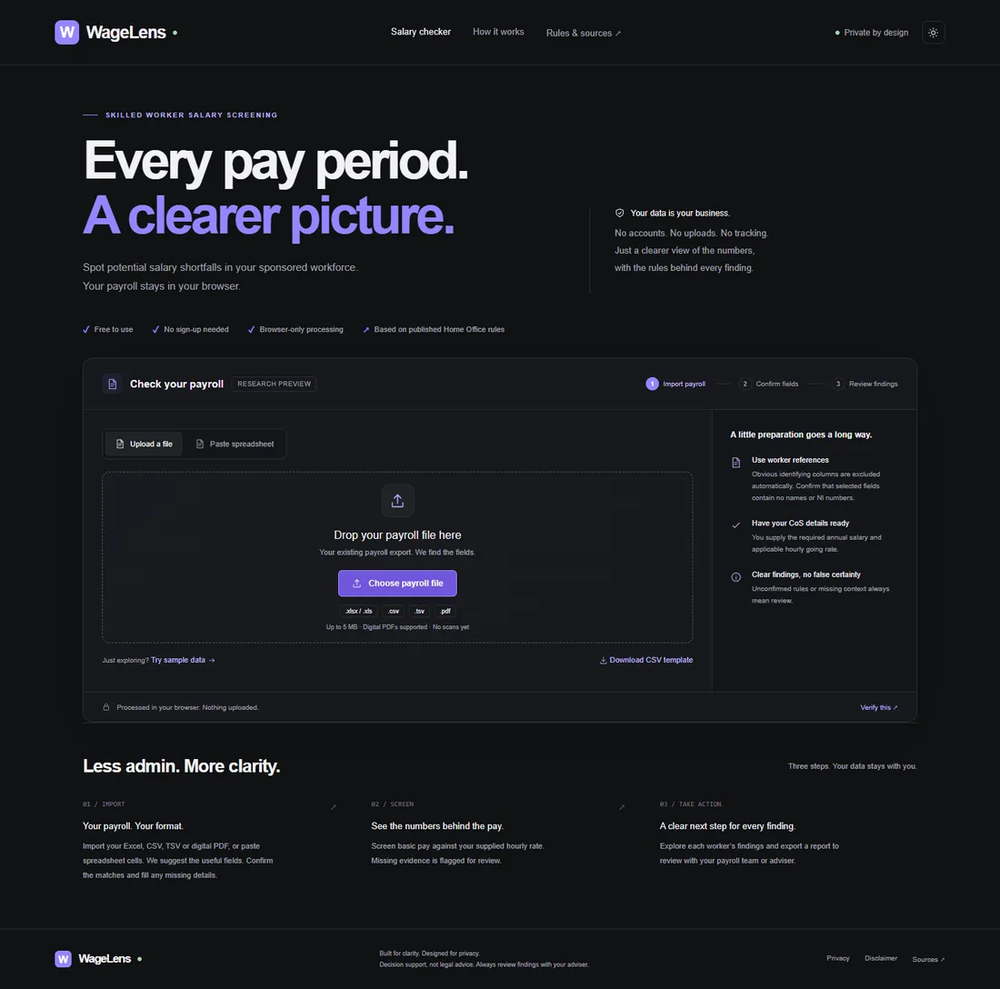

# WageLens

**Live research preview:** [Open WageLens](https://wagelensuk.wluk.workers.dev/#/).

[](https://github.com/shaswatshukla/wagelens/actions/workflows/ci.yml)



A privacy-first TypeScript portfolio project: local document recognition, conservative financial checks, accessible UX and browser-level privacy tests.

**Recruiter walkthrough:** [engineering decisions and a two-minute demo](docs/portfolio.md).


A private, static Skilled Worker payroll screening website. Bold dark theme, browser-only Excel/CSV/TSV and pasted-cell imports, column mapping, hourly arithmetic, per-period findings, CSV export and print-to-PDF.

Excel workbooks support `.xlsx` and `.xls`, with explicit selection when multiple visible sheets exist. Formula cells require a values-only sheet to avoid trusting stale cached results. Text inputs accept CSV or tab-separated cells from Excel/Google Sheets. Maximum file size is 5 MB and maximum table size is 10,000 payroll rows. SheetJS is bundled locally from its official 0.20.3 distribution; there are no runtime CDN requests.

Common payroll headings are matched automatically; title rows can be skipped, identifiers are excluded, and uncertain matches stay blank. The confirmation screen shows source headings and original values alongside editable extracted values, with per-row missing details and an explicit confirmation before screening. Unknown headings can be mapped manually or a different header row selected, without editing the original file. No CoS requirements or zero pay amounts are inferred.

Readable digital PDFs use a locally bundled PDF.js worker (at most 20 pages). Positioned tables and simple labelled payslips are supported as extraction suggestions. Scans/OCR, arbitrary Word documents, encrypted files and unreliable multipage payslip merging are unsupported. PDF layout extraction always needs human verification. See `docs/import-recognition.md`.

## Status

**Research preview, not the completed salary checker.** Overall findings remain REVIEW. Complete aligned 3-month and 12-week windows are screened. Arbitrary boundary allocation, 17-week pattern assessment, legal exception declarations, deadline calculations and production infrastructure remain outstanding. The owner has authorised a hosted portfolio demonstration; the app must remain clearly labelled as a research preview. Decision support, not legal advice.

## Run

Node 22+ and pnpm:

```sh
pnpm install
pnpm dev
pnpm test
pnpm coverage
pnpm build
```

Browser/privacy verification: `node scripts/browser-check.cjs` after building. It uses installed Edge on Windows; select another installed Chromium channel with `BROWSER_CHANNEL`. It saves screenshots, a print PDF, accessibility findings and Lighthouse output under ignored `test-results/`.

`dist/` is entirely static and portable. No application backend, database, cookies, analytics or remote fonts. Payroll lives in browser memory; no persistence. Exports stay on the device. Do not include names or NI numbers. Column checks cannot detect every identifier in cell contents.

Rules: `src/rules/skilled-worker.json`; source analysis: `docs/rules-spec.md`; acceptance fixtures: `docs/worked-examples.md`. The dates shown in the UI describe research verification, not solicitor sign-off.

The executable fixtures test the preview's conservative results; they do not certify all final worked-example window expectations. Money uses integer pence and BigInt comparisons for decimal hours; fractional minimum pence rounds upward when displaying potential gaps.

## Privacy verification

Serve the production build, clear the Network panel, then import, confirm, screen and export. No request may contain payroll data. Local parser modules and the PDF worker may load as fixed static assets; they have no document values in their URLs or request bodies. The browser test permits only exact known local asset URLs with GET and no body. External source pages open only on click. A host may log ordinary page loads. Add production HTTP headers before launch (see `public/_headers`).

## Hosting and maintenance

See [deployment and recovery](docs/deployment.md) for Cloudflare Pages, automated checks and the optional Oracle standby. The repository stays private. A hosted portfolio demonstration is authorised; a production compliance-service launch still requires solicitor review and completion of the outstanding work. No payroll backend is deployed.

